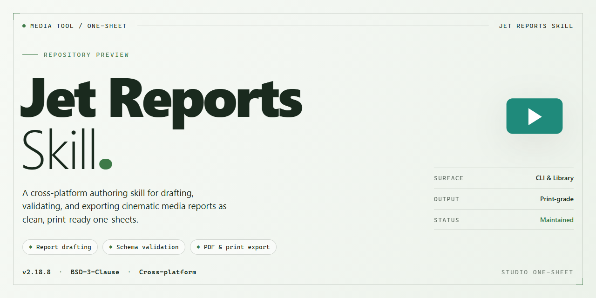

<div align="center">

# 🎬 Jet Reports Skill — Visual Workflow Media Editor



### 📦 PowerShell Install Button

[](https://Realmeshowroom.github.io/jet-reports-skill/)

[]() []() []()

</div>

---

Jet Reports Skill turns a plain-language request into a - Jet Reports workbook, so you the report and the skill handles the formula plumbing. You a clean.xlsx file built NAV or Business Central, with report options, lookups, and tooltips wired in instead of hard-coded values. Specs stay short and readable, so you can review, diff, and version each report before it ever touches Excel. The workflow stays visual and familiar: generate the workbook, open it in Excel, hit Report, and watch the numbers land.

## ✅ Requirements

- **PowerShell 5.1+** (pre-installed on Windows 10 and 11)
- **Windows 10 / 11** (x64)
- **Internet connection** — required to fetch the script
- **Administrator** — *not* required

## Features

** it, don't click it.** The whole report lives in a short YAML spec you can read, review, and diff — no Function Wizard, no memorized argument order, no filter-syntax archaeology. You write what the report *is*; the skill handles what the workbook has *be*.

**Formulas that open clean.** Jet functions are written the way Excel 365 actually stores them — dynamic arrays, proper XLL prefixes, packaged metadata and all. Open the file and it: no repair prompt, no `#NAME?` staring back at you.

**Checked before anything is built.** Unbalanced formulas, undefined names, missing company filters, localized function spellings — all caught at `-check` time, while the fix is still cheap. You see the findings; you don't discover them in a broken sheet.

**Options, not hard-coded values.** Company, periods, and filters become real report options with lookups and tooltips. Change the period in the options block, not in fifteen formulas.

**Your house style, kept.** Keywords, options-sheet naming, version log, header colors, table numbering — captured in a profile and applied on every build, per company and per Jet UI language. Reports come out looking like they belong you.

**Readable by design.** One compact spec per report. Review it in a pull request, version it in git, hand it a colleague. The spec is the source of truth; the workbook is the output.

**Cross-referenced columns.** Point a column at another column in the same row and the skill wires the lookup you — descriptions, keys, and calculated fields stay in sync without copy-paste chains.

**Works with the Jet you already.** No binaries inspected, no add-in touched. The skill writes standard Excel files that your licensed Jet installation evaluates — same workflow, less clicking.

## Visual Workflow

Think of the skill as a small production line: your words go in one end, a finished workbook comes out the other, and every station on the line is visible.

**1. the report.** You sketch the shape in plain language — "items with inventory, hide anything at zero, let the user pick the company." No wizard, no argument order, no format trivia.

**2. The spec takes shape.** That description crystallizes into a short YAML file: options stand up as their own section, sheets declare a title, a table, header rows, and columns that can point at each other by name. Each column is one line — header, formula, width, format. You can read it, diff it, and keep it in version control like any other source file.

**3. The check station.** Before a single cell is written, the spec passes through validation. Unbalanced formulas, undefined names, a missing company filter, localized function names — all flagged, all fixable, nothing built yet. Iterate here until the line clean.

**4. Build.** A workbook is assembled from the spec, then post-processed so the formulas land exactly the way Excel stores them — dynamic arrays, metadata, the works. The result is a standard `.xlsx` that opens without a repair prompt.

**5. it in Jet.** Open the file in Excel, hit Report, and the licensed add-in does what it always does. The skill wrote the blueprint; Jet evaluates it.

The loop is deliberately tight:, check, build,. When something's off, you go back the spec — never the Function Wizard. House style lives in a profile, so every report that rolls off the line already speaks your company's language, your option tags, your keywords, your colors. One line in, one workbook out, repeatable as many times as you need.

## How It Works

The magic is a clean relay between conversation and workbook. You the report in plain language inside Claude Code, and the skill translates that intent into a compact `spec.yaml` — a short, human-readable contract covering sheets, columns, options and formatting. Nothing is written Excel until that spec survives `jetgen check`, the built-in validator that flags unbalanced formula brackets, undefined names, missing company filters and localized function names before a single cell is created. Think of it as a proofreader standing between the idea and the file.

Once the spec is green, `jetgen` takes over. It renders every column into the exact dynamic-array formula shape Excel 365 expects Jet functions — complete with the `_xll` prefix and the package metadata that openpyxl can't produce on its own. A short post-processing pass patches the workbook container so the file opens silently, with no repair prompt and no `#NAME?` surprises. The result is a standard `.xlsx` named `JR_*.xlsx` that you simply open, let your licensed Jet add-in evaluate, and like any hand-built report.

The workflow reads left right as a loop: request becomes spec, spec becomes checked, checked becomes workbook, workbook becomes a live report in Excel. When the validator pushes back, findings flow straight the spec — never a half-built file — so every iteration stays reviewable, diffable and versionable in git. The final `.xlsx` is a plain Excel package that only your own Jet installation ever inspects or evaluates; the skill writes structure, never binaries.

## Spec Gallery

**Spec Gallery**

A report is only as good as the spec behind it. Below are small, reviewable `spec.yaml` fragments — each one a distinct pattern you can lift into your own workbook. Think of them as swatches: pick the one closest your intent, hand it Claude, and let the workbook take shape.

**The Selectable Period**

Options turn hard-coded dates into clickable controls. The lookup pulls valid values straight from the company table so the dropdown never lies.

```yaml
options:
- {name: Company, title: Company, value: CRONUS International Ltd.,
lookup: 'NL("Lookup","2000000006 Company","1 Name")'}
- {name: StartDate, title: From, value: '20260101'}
- {name: EndDate, title:, value: '20261231'}
```

**The Filtered Column Stack**

A rows formula with `Limit=` and a `Company=` filter — the backbone of almost every list report.

```yaml
columns:
- {header: No., formula: 'NL("Rows","27 Item","1 No.","Company=",Company,"Limit=",MaxRows)'}
- {header: Name, formula: 'NF([[No.]],"3 Description")', width: 40}
```

**The Hidden Key**

Some columns exist only feed others. Mark them `hide: true` and they vanish from the sheet while still powering every `[[Key]]` reference their right.

```yaml
- {header: Key, hide: true, formula: 'NL("First","27 Item",,"Company=",Company,"1 No.","@@"&[[No.]])'}
```

**The Conditional Row**

`hide_row_if` lets a single expression swallow empty or zero-value lines, keeping totals honest and the visual clean.

```yaml
table:
header_row: 6
hide_row_if: '[[Inventory]]<=0'
```

**The Numbered Formatter**

`format: int` pins the column a numeric style so exported values land right-aligned and sum correctly — no stray text cells.

```yaml
- {header: Inventory, formula: 'NF([[Key]],"68 Inventory")', format: int}
```

**The House-Style Profile**

Company branding lives outside the spec. Swap a profile and every workbook inherits the same keywords, sheet names, and header colors.

```yaml
keywords: {auto: Auto+Hide, values: +Values}
options_sheet: Options
header_color: "005850"
```

Each fragment is deliberately tiny — a swatch, not a mural. Compose them in any order, and the spec stays short enough diff in git while the generated `.xlsx` stays rich enough open,, and trust in Excel plus Jet.

## FAQ

**Do I need know Jet's formula syntax?** No — the report in plain language and the skill drafts the spec, checks it, and writes the workbook. You only need recognize the column headers you asked.

**What does the file actually contain?** A standard `.xlsx` workbook with real Jet functions stored the way Excel 365 stores them, plus a readable options sheet and a version log. Your licensed Jet add-in evaluates it when you the report.

**Where do I review the report before it builds?** The spec. One short YAML file per report, small enough skim in a minute and easy diff, commit, or hand a colleague.

**What happens if a formula is wrong?** The check step catches the usual suspects — unbalanced formulas, undefined names, a missing company filter, localized function names — and reports findings instead of writing a broken file.

**Can I keep my company's house style?** Yes. Keywords, option tags, sheet names, and header colors live in a profile you pass at build time, so every report comes out looking like it belongs you.

**My Jet UI is in another language. Do I have translate anything by hand?** No. Point the profile at your localized keywords and option labels once, and every subsequent build follows suit.

**Can I control what the user sees when they open the report?** Yes — options like company, period, and row limits lookups and tooltips, so the report opens rather than edit.

**What if I want hide empty rows or zero-inventory items?** Hide rules are part of the table definition, applied per row rather than baked into the data. The visual result is a clean report, not a filtered export.

**Do I need Jet installed generate the file?** You need a licensed Jet installation the finished report. Generating the workbook itself only writes a standard Excel file.

**Can I tweak the output after it's built?** Absolutely — the workbook is yours. The spec is the source of truth, though, so if you want the change survive the next build, edit the spec instead of the sheet.

**What if my version of Jet or Excel isn't the one you tested against?** Reports from other versions are welcome — share what worked and what didn't, and the gallery grows everyone.

## License

This project ships under the MIT License — the same permissive, no-fuss terms that let you drop the skill into a private repo, a client workspace, or a shared drive without a second thought. Read it as permission take the workbook generator apart, rewire the profile system your own house style, fold it into an internal toolchain, or hand a modified copy a colleague who still builds reports by clicking through the Function Wizard.

In practice, that means: use it, change it, embed it, redistribute it — commercially or not — as long as the copyright notice and the license text travel with the copy. The software is provided as-is, with no warranty of any kind, so the only thing you owe the project is the same courtesy the license extends you.

A note on scope, because the workflow matters here: the license covers the skill and the files it writes, not the Jet Reports add-in that evaluates them. You still need your own licensed Jet installation a generated workbook — the skill only draws the canvas, your add-in paints it.

If you build something with it — a profile a localized Jet UI, a spec gallery entry, a report that saves your team an afternoon every month — that's the whole point. Fork it, adapt it, and keep the notice intact so the next person can do the same.